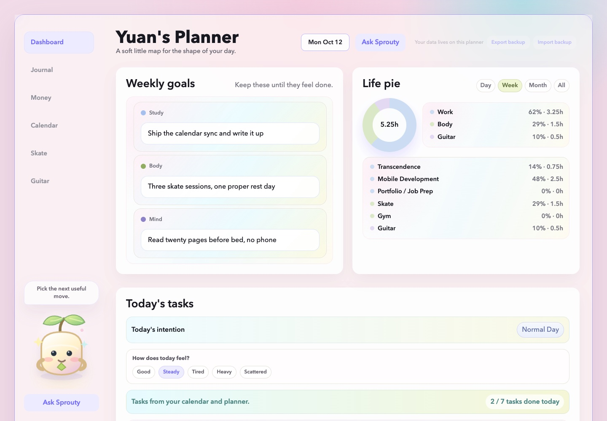
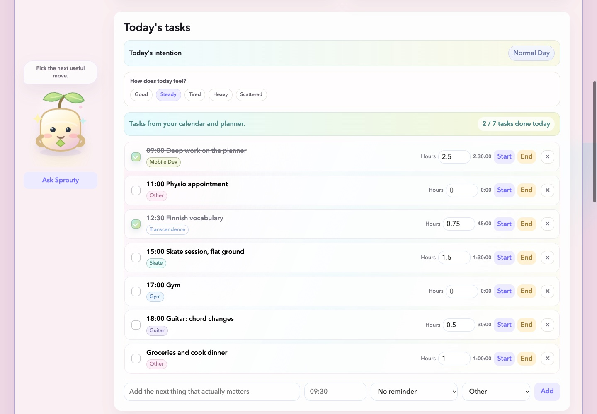
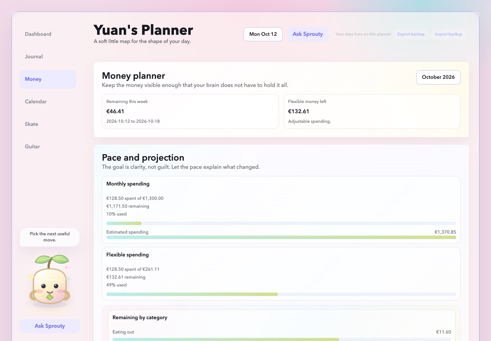
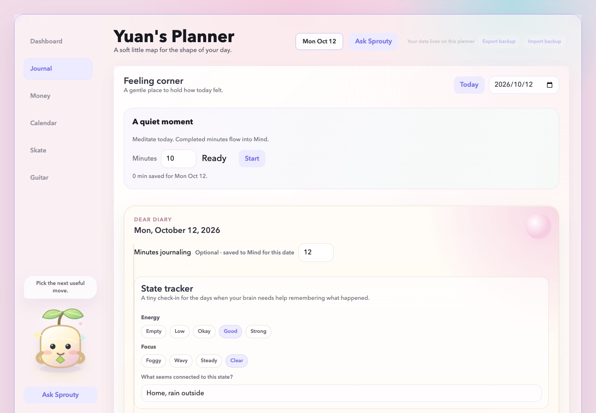
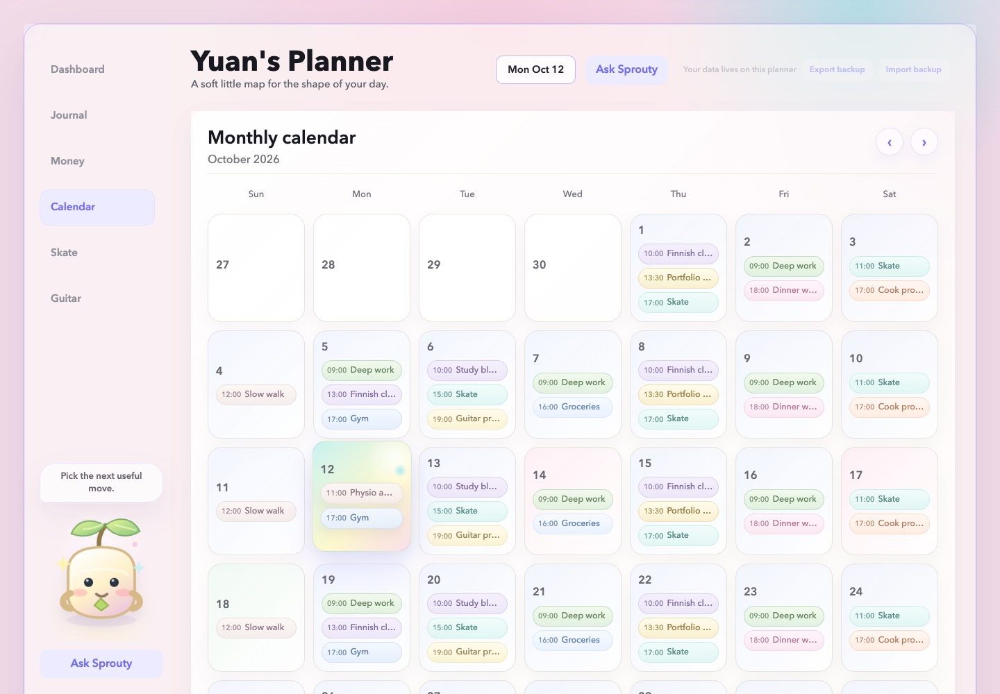
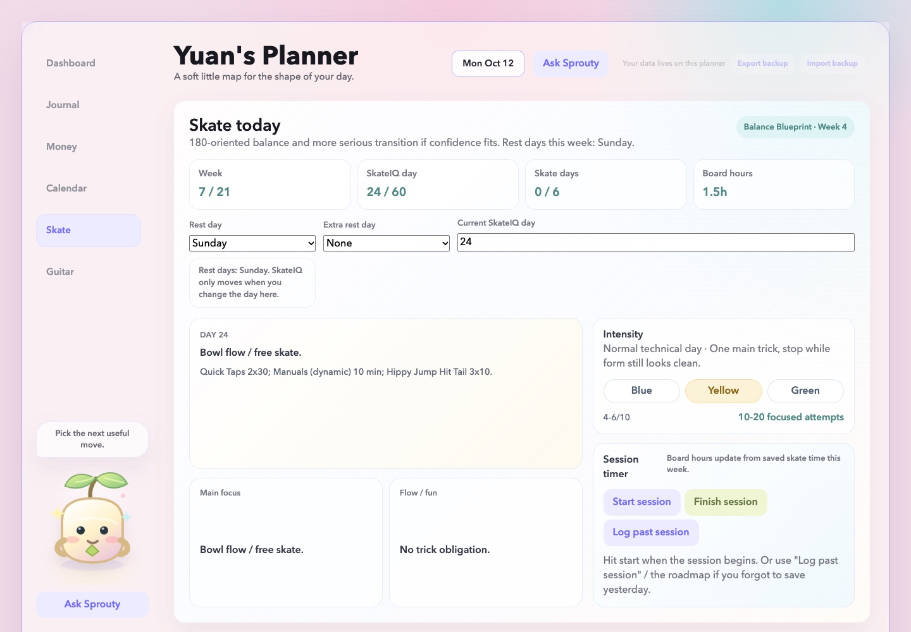

<div align="center">

# Yuan's Planner

**A soft little map for the shape of your day.**

Tasks, money, journal, calendar and practice tracking, all in one place.
This is a hobby project with AI assistance. I built it for myself, and I use it every day.

</div>

## Why I built it

I was always feeling busy, and somehow still reached the end of the week with little to
show for it. I never really knew where my time had gone, nor my money.

So I built something that shows me both: the hours going in, the money going
out, and how the days actually went.

It has made a real difference to how I live. My weeks have far more structure
now, and I can see what I actually did with them instead of guessing.

I host it myself. There is no public demo, since it holds real data.

<br />

<table>
<tr>
<td width="50%"></td>
<td width="50%"></td>
</tr>
</table>


<br />

## What's inside

<table>
<tr>
<td width="50%" valign="top">

### Money

Where the money goes. What's left this week, whether I'm on pace for the month,
which categories are nearly out, and which shops I keep going back to.



</td>
<td width="50%" valign="top">

### Journal

How the day went, in my own words. Energy and focus alongside it, everything
searchable later, and a meditation timer that counts towards the day's hours.



</td>
</tr>
<tr>
<td width="50%" valign="top">

### Calendar

What's planned, by month and by week. Each day is a recovery, normal or
high-intensity day with a limit, so I can see a week is too full before I live it.



</td>
<td width="50%" valign="top">

### Skate

A 21-week plan with something to work on each day, how hard to push, and a
timer. Gym and body work count too, and the roadmap covers the whole season.



</td>
</tr>
</table>

Also in there:

- **Guitar practice** — one focus, one small thing to practise, a timer, and a
  weekly target that is deliberately modest.
- **Sprouty** — ask about your own data and it answers from what is stored:
  what's left this week, where the hours went. With an `OPENAI_API_KEY` it
  reasons over that evidence and gives better suggestions; without one, or if
  the server is unreachable, it falls back to local answers computed from the
  same data. Either way it only uses what is actually stored, and says so when
  it doesn't know.
- **Planned vs actual** — the hours I meant to spend next to the ones I did.
- **Energy trail** — how energy and focus moved over the past days.
- **Pattern noticed** — one observation at a time, with the evidence behind it,
  and a history of the earlier ones.
- **Backup export and import** — the whole planner as one JSON file.

Every page is fully responsive and works on the phone.

<br />

## Quick start

You need **Python 3.9+** and **Node.js 20.19+**. The Python that ships with
macOS works, so there is nothing to install on a Mac beyond Node.

```sh
git clone https://github.com/Justyuanz/Yuans-planner.git YuanPlanner
cd YuanPlanner
cd frontend && npm ci && npm run build && cd ..
./scripts/start.sh
```

Open **[localhost:8765](http://127.0.0.1:8765)**.

<details>
<summary><b>Other ways to run it</b></summary>

<br />

Start the server directly with `python3 backend/app.py`, or pick a port:

```sh
YUAN_PLANNER_PORT=8876 ./scripts/start.sh
```

On macOS, `./scripts/open-ui.sh` starts the server if it is not already running
and opens the app.

For frontend work, run `npm run dev` from `frontend/` while the Python backend
is running; Vite proxies API requests to port 8765.

With Docker:

```sh
docker compose up --build
```

Compose mounts `./data` for persistent storage; stop it with `docker compose down`.
The image builds the bundle in a Node stage and copies only the compiled files
into the Python runtime image. Compose does not forward optional integration
settings or copy your `.env`, so add any you need to the service's `environment`.

</details>

<br />

## How it is built

| Layer | Choice |
| --- | --- |
| Frontend | React 19, TypeScript in strict mode, Vite |
| Backend | Python standard library only, no dependencies |
| Storage | SQLite, a single file |
| Styling | Plain CSS, split by surface |

Source is grouped by the page it belongs to:

```text
frontend/src/
├── pages/<page>/     calendar · dashboard · guitar · journal · money · skate
│   └── cards/        one directory per card, model and tests beside it
├── shared/           anything two pages both need
├── mascot/           Sprouty, which reads across every page on purpose
├── app/              shell, routing, store, persistence
├── api/              the HTTP client
└── styles/           the stylesheet, split by surface
```

Imports reach outside their own directory through `@/`; a lint rule rejects
deeper relative paths.

**[docs/architecture.md](docs/architecture.md)** has the full picture: the
request path, the storage contract, the rules the structure follows, and the two
places where Python and TypeScript must agree on a record's shape.

<br />

## Tests

```sh
cd frontend && npm ci && cd ..
NODE_BIN=$(which node) sh scripts/test.sh
```

Four layers:

| Layer | Count | Covers |
| --- | --- | --- |
| Python `unittest` | 22 | Server, storage, configuration, and the optional mascot integration. |
| Vitest | 324 | Models and rules, against malformed and boundary input. |
| ESLint + `tsc --noEmit` | — | Strict types, no `any`, no deep relative imports. |
| Node `--test` + Chrome | 49 | The production bundle in a real browser. |

The browser tests assert **pinned contracts** — text, computed styles, geometry
and tolerant image signatures — so an accidental visual change fails the build.
They also cover persistence across a reload *and* across a server restart,
backup export and import, and that the Python and TypeScript halves still agree
on the records they share.

That layer needs Chrome or Chromium, and it is a **local** gate: the pinned
contracts measure text in a font stack that only resolves on macOS, so they
cannot pass on a Linux CI runner and regenerating them there would break them
here. Run `scripts/test.sh` before pushing.

CI runs what it can check honestly: the Python tests, the frontend unit tests,
lint and strict types, the production build, a browser-free smoke test that
serves the built bundle and exercises the storage, backup and restart paths,
and a Docker build that boots the image and fetches all six pages.

Every test uses a temporary database, so none of it touches your planner data
or calls an external service.

<br />

## Configuration

The backend reads an optional `.env` in the project root; existing shell
variables take precedence. Keep credentials out of Git.

| Variable | Default / purpose |
| --- | --- |
| `YUAN_PLANNER_HOST` | `0.0.0.0` (all interfaces); use `127.0.0.1` for local-only access |
| `YUAN_PLANNER_PORT` | `8765` |
| `YUAN_PLANNER_DB_PATH` | `data/planner.db`; relative paths resolve from the project root |
| `OPENAI_API_KEY` | Optional key for mascot chat |
| `YUAN_PLANNER_OPENAI_MODEL` | `gpt-5-mini` |
| `YUAN_PLANNER_OPENAI_TIMEOUT_SECONDS` | `20` (clamped to 5–60 seconds) |

The mascot integration is optional; the planner is fully usable without it.

<br />

## Data and backups

The server creates `data/planner.db` on first run. Local databases, credentials,
logs and `backups/` are ignored by Git.

Use the app's export and import buttons, or take a backup from the command line:

```sh
curl http://127.0.0.1:8765/api/export -o yuan-planner-backup.json
```

An import merges valid planner keys into existing data, replacing matching keys.
